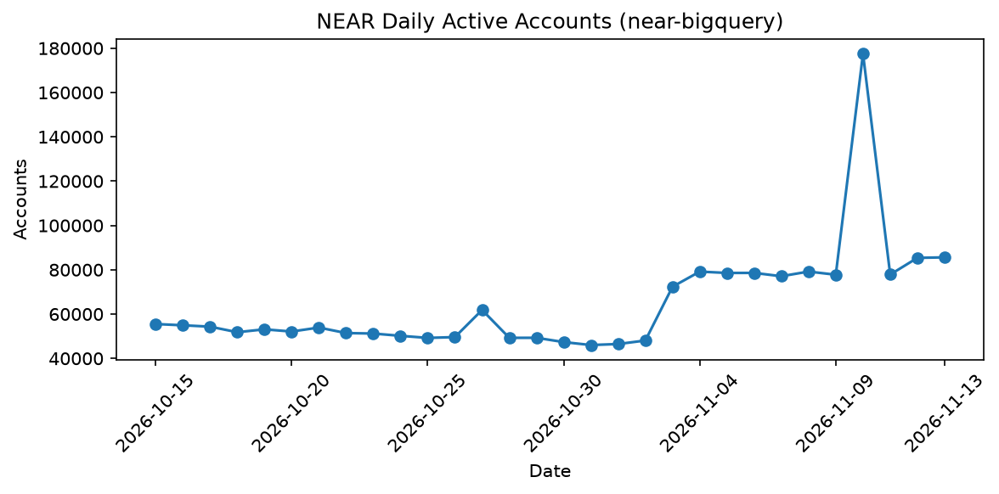
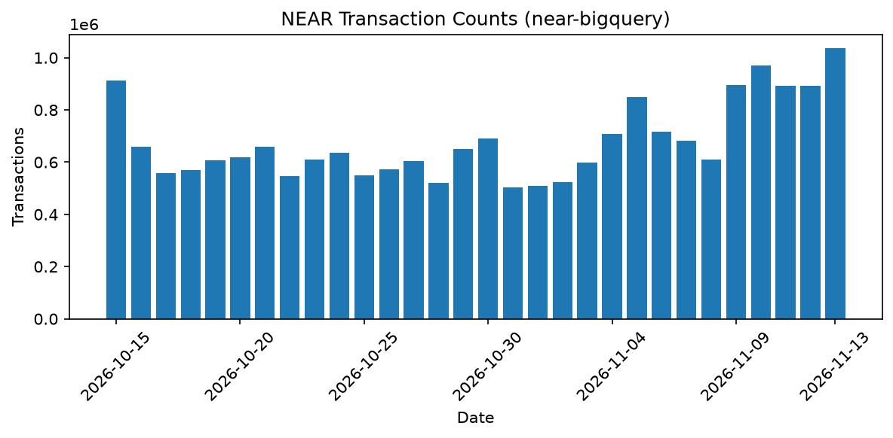
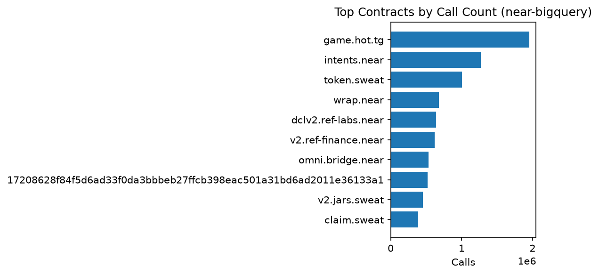
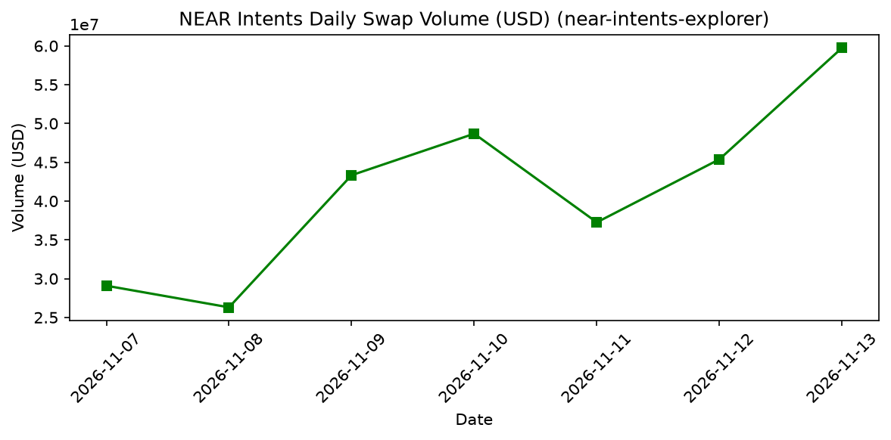

# NEAR Thesis Engine: economic activity with verifiable evidence

Investment Thesis track · NEAR HACKATHON 2026 · Research snapshot: November 14, 2026. This expanded analysis was written after entry 2 was sealed. Entry 2 commits the original result and its evidence, not the text or new calculations in this report.

## Investment thesis and current finding

The research hypothesis is that NEAR Intents settlement activity can predict subsequent NEAR network usage better than NEAR token price. The investment rationale is to examine observable economic activity alongside market valuation. This dataset establishes measurable 1Click activity and a reproducible evidence workflow. It does not yet establish predictive superiority, causality, token value accrual or an investment return.

The frozen snapshot contains 144,458 successful 1Click swaps and $289,787,516.06 of reported inbound USD value over November 7–13. The network series contains 20,344,165 transaction records over October 15–November 13. These windows end before November 14 UTC and exclude the incomplete current day.

## Measured network activity

| Measure | Result | Interpretation |
|---|---|---|
| Daily active signers, first → last day | 55,503 → 85,595 (+54.22%) | Accounts signing transactions; not unique humans |
| Daily transactions, first → last day | 911,980 → 1,036,324 (+13.63%) | Transaction records; not receipt actions |
| Mean daily active signers, first / last seven days | 53,673 / 94,331 (+75.75%) | Oct 15–21 versus Nov 7–13; averages reduce endpoint dependence |
| Mean daily transactions, first / last seven days | 654,548 / 853,841 (+30.45%) | Same nonoverlapping seven-day windows |
| Most-called observed contract, Nov 7–13 | game.hot.tg — 1,952,431 function-call actions | Activity rank is not a measure of revenue or unique users |

## Seven-day aligned evidence

| UTC date | 1Click swaps | Inbound USD | Mean USD / swap | Active signers | Transactions |
|---|---|---|---|---|---|
| 2026-11-07 | 17,300 | $29,084,781.89 | $1,681.20 | 77,076 | 682,432 |
| 2026-11-08 | 14,651 | $26,301,194.03 | $1,795.18 | 79,184 | 609,504 |
| 2026-11-09 | 20,243 | $43,331,710.01 | $2,140.58 | 77,752 | 895,302 |
| 2026-11-10 | 21,953 | $48,679,672.70 | $2,217.45 | 177,510 | 970,505 |
| 2026-11-11 | 20,480 | $37,258,176.59 | $1,819.25 | 77,831 | 891,297 |
| 2026-11-12 | 23,226 | $45,384,106.60 | $1,954.02 | 85,370 | 891,523 |
| 2026-11-13 | 26,605 | $59,747,874.26 | $2,245.74 | 85,595 | 1,036,324 |

The mean reported inbound value is $2,006.03 per swap. Daily volume changes +105.43% from the first to last day; swap count changes +53.79%. Volume therefore reflects both transaction frequency and average transaction size. This is a descriptive endpoint comparison, not a trend estimate or evidence of future performance.

USD totals sum the Explorer amountInUsd once per SUCCESS record by its UTC creation date, using decimal arithmetic. They cover the 1Click Explorer population, not all NEAR Intents activity, fees, protocol revenue, NEAR-denominated demand or unique people. The source records are observations from a mutable service; later settlements or backfills can change a future pull.

## Exploratory relationship with network usage

| Comparison | Paired days | Pearson r |
|---|---|---|
| Same-day 1Click volume and active signers | 7 | 0.346 |
| Same-day 1Click volume and transactions | 7 | 0.946 |
| Today’s volume and next day’s active signers | 6 | 0.297 |
| Today’s volume and next day’s transactions | 6 | 0.600 |

These correlations use the overlapping dates only, raw daily levels, no detrending and no controls. The lagged calculation pairs November 7–12 volume with November 8–13 usage. Six or seven observations cannot distinguish stable predictive content from coincident trends, weekday effects or an outlier. No significance or causal claim is made, and these calculations do not compare against price. They are diagnostics for designing the next study, not confirmation of the hypothesis.

## Charts from the sealed evidence

### Daily active signer accounts

### Daily transaction records

### Observed contract function-call activity

### Successful 1Click inbound USD volume

## Counterarguments and investment implications

Higher swap activity could reflect incentives, routing changes, repeated automated transactions or larger tickets rather than durable adoption. Activity concentrated in a popular application may reverse. Even persistent cross-chain activity does not establish that fees, token holding demand or investor returns rise proportionally. USD volume can also change with underlying asset prices. The report therefore supports monitoring economic use, while leaving the valuation and forecasting bridges to be measured.

## What would strengthen or weaken the thesis

Collect at least 90 aligned daily observations as an initial study, and preferably multiple market regimes. Freeze the sample boundary and obtain a documented NEAR/USD price series. Compare rolling forecasts for next-day active signers and transaction counts: a usage-history baseline; usage plus price features; usage plus Intents features; and the combined model. Choose lags and transformations using training data only, reserve future observations for evaluation, and compare forecast error with uncertainty and sensitivity to unusual days. Ninety days is a starting sample, not a guarantee of sufficient power.

Consistent out-of-sample improvement from Intents features over both the usage-only and price-feature baselines would strengthen the claim. No improvement, reversal across periods, or dependence on a handful of unusually large swaps would weaken it. A rise in volume while price is flat, or a single Granger-test p-value, would not by itself prove the comparative leading-indicator claim.

## Provenance and verification

BigQuery tables: bigquery-public-data.crypto_near_mainnet_us.transactions and bigquery-public-data.crypto_near_mainnet_us.receipt_actions. Queries use explicit lower-inclusive, upper-exclusive block_date parameters. Intents endpoint: https://explorer.near-intents.org/api/v0/transactions. The complete seven-day subwindow was retained after contiguous newest-first pagination crossed its lower boundary; the attempted longer pull was stopped for the demo deadline. Four gzip JSONL parts preserve all contributing records, with compressed and uncompressed SHA-256 hashes.

| Verification item | Value |
|---|---|
| Network / contract | NEAR Testnet / redsigma.testnet |
| Entry | 2 |
| Store transaction | 2QawvYNZ3783ApE7vHUHNHS2mUT1g78uTu2CmuLaE3qA |
| Sealed payload SHA-256 | 2064d65c0af85b5359ea0f1b1d54156541423b6198288f750dac3c356cd77c3f |
| Frozen raw-data SHA-256 | 12545456fe21afeb507b4002a72279384a5f6231acd8ba9135b0f5a9302aea99 |
| Original candidate check | Contract verification true AND exact retrieved-content equality true |
| One-character edit demonstration | Contract verification false AND exact equality false |

Sealed Log preserves the existing 231-gate checksums, which have known collisions and are not cryptographic collision resistance. The app also compares the retrieved action_data string exactly. A matching record establishes the demonstrated content comparison; it does not authenticate the upstream data provider, prove completeness of the external API, or validate the research hypothesis. SHA-256 identifies the local evidence artifacts.

## Reproduce the report

From the feature branch, install the documented dependencies, then run: python scripts/verify_evidence.py --result submission/result.json ; python scripts/build_research_report.py . The first command streams and checks every archived swap and reconstructs daily totals; the second produces this report and machine-readable analysis offline. Commands are separate steps. Credentials and a fresh API pull are not needed for the frozen evidence. Live data refreshes require your own GCP and Explorer authorization.

Source: https://github.com/chadcoulter/near-thesis-engine/tree/feat/testnet-hackathon-demo . Public transaction: https://testnet.nearblocks.io/txns/2QawvYNZ3783ApE7vHUHNHS2mUT1g78uTu2CmuLaE3qA
