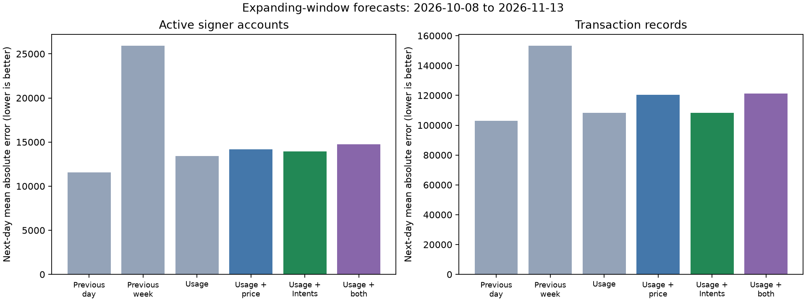

# NEAR thesis: 90-day predictive comparison

Post-deadline research extension. This analysis was produced after the hackathon deadline. It is not part of the entry-2 sealed payload. No new on-chain result has been submitted.

## Finding

The Intents-augmented model has lower MAE than the price-augmented model for both outcomes in this evaluation. The paired uncertainty intervals do not establish an Intents advantage over price for both outcomes. Intents does not improve on usage-only MAE for both outcomes. Previous-day persistence has the lowest MAE among all six models for both outcomes. This test does not establish that Intents is a reliably better leading indicator than price with incremental value over recent usage.

## Data

90 completed UTC days: August 16–November 13, 2026. 1,942,354 successful 1Click records; $3,927,512,808.35 reported inbound value. BigQuery supplies daily transaction counts and distinct signing accounts. CoinGecko supplies NEAR/USD aggregate reference prices at 00:00 UTC; the t+1 midnight point is used as the end-of-day reference for day t. It is not an exchange OHLC close.

## Test design

Predict next-day usage, separately for active signers and transactions. Use 45 initial training pairs and an expanding training window; 37 future dates (2026-10-08–2026-11-13) are scored. Each forecast uses only features through its origin day and training targets observed by that day. Standardization is refit inside each training window. Ridge alpha is fixed at 1.0. There is no holdout tuning. All models are scored on exactly the same dates.

The usage model includes log1p usage at t, t−1 and t−7 and target-weekday sine/cosine. The price model adds log reference price and its daily log return. The Intents model adds log1p inbound USD volume and its daily change. Both use two additional features. A combined model and previous-day/previous-week persistence baselines are included. Targets are fit in log1p units and evaluated as counts after inverse transformation; no inverse-transform bias correction is applied. Primary metric: mean absolute error (MAE). RMSE is secondary. This protocol was fixed before fitting this run, not externally preregistered.

## Active signer accounts

| Model | MAE ↓ | RMSE ↓ |
|---|---:|---:|
| persistence | 11,555.00 | 28,716.34 |
| seasonal_persistence | 25,922.65 | 44,010.23 |
| usage | 13,416.30 | 28,848.72 |
| usage_price | 14,162.14 | 29,434.57 |
| usage_intents | 13,938.89 | 29,632.21 |
| usage_price_intents | 14,771.02 | 30,277.50 |

Compared with usage, adding Intents instead yields -3.90% MAE reduction. Mean paired error advantage: -522.59 counts; approximate 95% seven-day moving-block bootstrap interval [-1,143.93, 51.23]. Positive means Intents has lower error; an interval spanning zero does not distinguish the models reliably in this test.

Compared with usage_price, adding Intents instead yields +1.58% MAE reduction. Mean paired error advantage: 223.25 counts; approximate 95% seven-day moving-block bootstrap interval [-519.91, 1,109.54]. Positive means Intents has lower error; an interval spanning zero does not distinguish the models reliably in this test.

## Transaction records

| Model | MAE ↓ | RMSE ↓ |
|---|---:|---:|
| persistence | 103,047.78 | 140,551.47 |
| seasonal_persistence | 153,288.57 | 195,087.39 |
| usage | 108,230.50 | 134,890.25 |
| usage_price | 120,363.96 | 146,019.46 |
| usage_intents | 108,240.32 | 137,411.57 |
| usage_price_intents | 121,273.69 | 148,808.90 |

Compared with usage, adding Intents instead yields -0.01% MAE reduction. Mean paired error advantage: -9.82 counts; approximate 95% seven-day moving-block bootstrap interval [-3,484.43, 3,888.58]. Positive means Intents has lower error; an interval spanning zero does not distinguish the models reliably in this test.

Compared with usage_price, adding Intents instead yields +10.07% MAE reduction. Mean paired error advantage: 12,123.64 counts; approximate 95% seven-day moving-block bootstrap interval [-20,432.99, 44,653.69]. Positive means Intents has lower error; an interval spanning zero does not distinguish the models reliably in this test.

## Interpretation and limits

Judge the claim separately for both outcomes using the table above. Lower Intents MAE than price is evidence in favor within this window; higher MAE is evidence against. If Intents does not also beat the usage-only model, it has not shown incremental predictive usefulness over usage history. Mixed outcomes do not confirm a general leading-indicator claim. A confidence interval spanning zero leaves the comparison inconclusive.

This is a small, single-period retrospective forecasting experiment. The downloaded historical series may have been revised; the test cannot reproduce what each API actually published in real time. It is a pseudo-out-of-sample evaluation, not a live forecasting trial. The protocol uses observed daily totals available after the UTC day ends, without modelling ingestion delays. Pearson correlation, causality, price returns and investment profitability are different questions. USD swap volume can co-move with asset prices; account counts are not unique humans. Multiple targets and model comparisons are reported without multiplicity-adjusted significance claims. Block-bootstrap intervals are approximate and sensitive to sample size and block choice.

## Provenance and reproduction

The Intents archive contains all contributing SUCCESS records in 33 compressed JSONL parts. Its 90-day pull resumes validated newer pages from the earlier collection, retaining their original bytes; older pages were collected later. Cursor pagination is not an atomic snapshot. The independently executed archive verifier reconstructs all daily decimal totals and checks archive hashes, record uniqueness, status and date bounds. Exact API/query provenance and source hashes accompany the result JSON.

Run `python scripts/fetch_comparison_data.py` for network and price inputs; collect the documented 90-day window with `scripts/fetch_intents_history.py`; run `python scripts/compare_predictors.py`. The forecasting calculation is offline once its three input JSON files are available. The full per-swap audit archive is retained locally; aggregate inputs and forecast predictions are supplied for lightweight reproduction.

